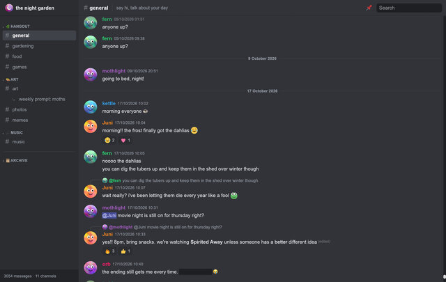
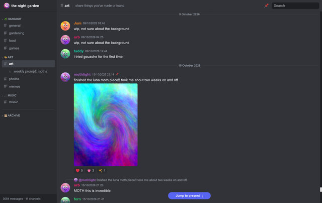
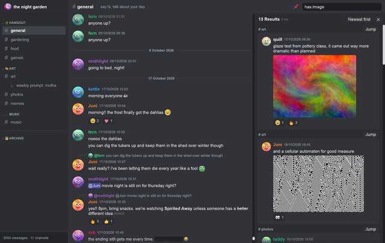
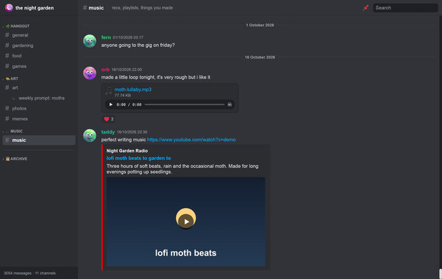
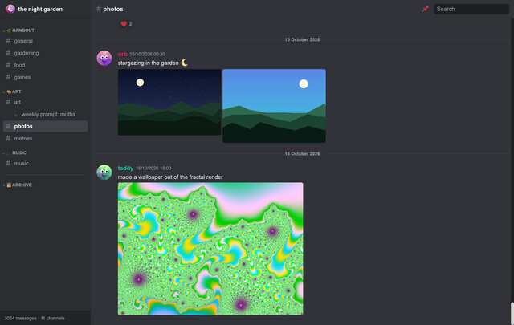
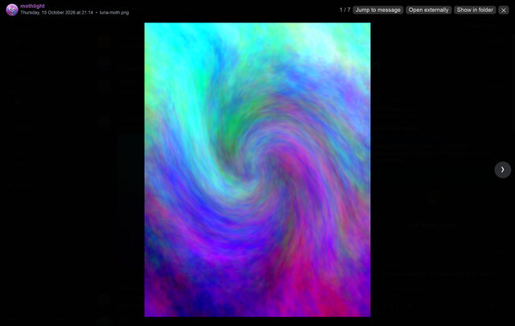

# discord-viewer

<a href="screenshots/chat.jpg"></a>
<a href="screenshots/art.jpg"></a>
<a href="screenshots/search.jpg"></a>
<a href="screenshots/music.jpg"></a>
<a href="screenshots/photos.jpg"></a>
<a href="screenshots/lightbox.jpg"></a>

A desktop app for reading an exported Discord server. It looks and works roughly like Discord: channels down the side, messages with avatars, replies and reactions, and all the images, GIFs, videos and audio showing inline. It all runs offline, from files on your own disk.

I wanted a copy of our server that doesn't depend on Discord sticking around, and years of chat as a folder of JSON files isn't much fun to read. [DiscordChatExporter](https://github.com/Tyrrrz/DiscordChatExporter) does the actual exporting. This repo has a script that runs it for a whole server, and the viewer that makes the result nice to browse and search.

(Everyone and everything in the screenshots is made up. They come from the demo data described below, not from a real server.)

## What's in it

**The viewer** shows channels and threads in the same order as on Discord, with any archive category tucked away at the bottom. Messages get the full treatment: Discord's markdown, custom and Unicode emoji, mentions, replies you can click to jump to, forwards, spoilers you click to reveal, stickers, reactions (hover to see who reacted) and link embeds.

**Media plays inline.** Images and animated GIFs show in the chat. Videos play in place with a seek bar, Tenor-style GIFs loop silently like they do on Discord, and audio files get a little player. Click any image or video to open it full screen, where you can zoom with the scroll wheel, drag to pan, and use the arrow keys to step through every picture and video in the channel.

**Search** covers every channel at once and runs as you type. It understands the same filters as Discord: `from:`, `in:`, `has:image` (or `video`, `audio`, `file`, `link`, `embed`, `sticker`, `reaction`), `before:`, `after:`, `during:`, `pinned:true`, and "quoted phrases". Results come with a Jump button that takes you to the message in context. The pin button in the header lists a channel's pinned messages.

**The export script** (`export/export.sh`) downloads DiscordChatExporter if it isn't there yet and exports every channel, thread and forum post. It downloads the attachments, avatars and emoji too, so the archive doesn't depend on Discord's servers. It also saves the server's channel order, emoji and stickers, so the viewer can lay things out the way Discord does. Each run is a new snapshot, and media is shared between snapshots so re-exporting doesn't download everything again.

## How it works

Big servers are the point, so the viewer is built to stay quick with them. Ours has about 140,000 messages and loads in under a second. The JSON is parsed on every core at once, and search is a straight scan over pre-lowercased text, which takes a few milliseconds even across everything.

The message list only lays out the messages near what's on screen. Every message has a different height, so each one's height is measured when it's drawn and estimated until then. Scrolling is anchored to the message at the top of the view, which stops the page jumping around as images further up finish loading.

Images are decoded and shrunk on background threads, then kept on the GPU with the least recently used ones dropped when memory gets tight. Video and audio are decoded by piping ffmpeg's output straight into the app. Audio goes through rodio, and the number of samples actually played is the clock that video frames are timed against, so they stay in sync.

## Getting it running

You'll need [Rust](https://rustup.rs) and [ffmpeg](https://ffmpeg.org) (on a Mac, `brew install ffmpeg`). ffmpeg is what plays videos and audio and makes video thumbnails. Without it everything else still works. I've only tried it on macOS so far, but nothing in it is Mac-specific.

### Try it with the demo server

If you just want to see what it's like, make the demo server and open it. This needs Python 3 and [ImageMagick](https://imagemagick.org) as well:

```sh
python3 demo/make_demo.py
cargo run --release -- demo/output
```

### Export your own server

DiscordChatExporter needs a bot token, and the bot needs to be in your server:

1. In the [Discord developer portal](https://discord.com/developers/applications), make a new application. Under **Bot**, reset the token and copy it, and turn on **Message Content Intent**.
2. Under **OAuth2 → URL Generator**, tick `bot`, then **View Channels** and **Read Message History**, and open the link to add the bot to your server.
3. Save the token to `private/token`.
4. In Discord, turn on Developer Mode (Settings → Advanced), then right click your server and **Copy Server ID**.

Then run the export, and open the viewer:

```sh
export/export.sh 123456789012345678    # your server ID
cargo run --release
```

The export needs bash and Python 3, and can take a while on a big server. The viewer finds the latest export by itself. You can also pass a folder to open: `cargo run --release -- path/to/export`.

Only export servers you're allowed to. The bot can only see the channels its role can see.

## Where things go

Everything private lives in `private/`, which git ignores:

```
private/
  token            your bot token
  server-id        optional: saves typing the server ID every time
  bin/             DiscordChatExporter, downloaded on first run
  data/
    exports/<date>/   one folder per export: a JSON file per channel
    latest            points at the newest export
    media/            every attachment, avatar and emoji, shared between exports
```

Video thumbnails are cached in `~/Library/Caches/discord-viewer` on a Mac and `~/.cache/discord-viewer` elsewhere.

## Licence

MIT, see [LICENSE](LICENSE).
